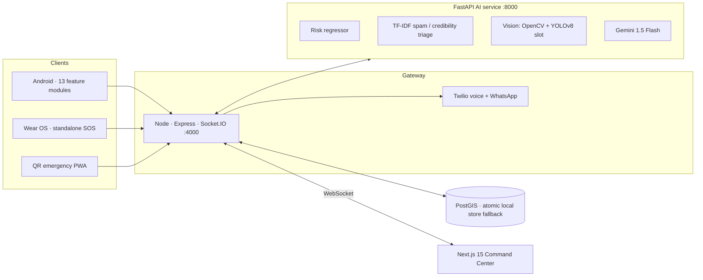

<div align="center">


<a href="https://git.io/typing-svg"></a>


[📘 Project Guide](PROJECT_GUIDE.md) · [🎤 5-min demo script](PROJECT_GUIDE.md#17-hackathon-5-minute-live-demonstration-script) · [🛠 API catalog](PROJECT_GUIDE.md#13-developer-api-reference-with-curl-examples)


</div>

---

## The problem

In an Indian city, a woman's SOS, a flooded underpass, a pothole a contractor was paid to fix, and a traffic fine are handled by four different systems — or none. Reports get lost, alerts reach nobody, and nobody is accountable.

## What NagarSetu does

It puts all of it into **one live loop**:

<p align="center"></p>

```
Citizen / Smartwatch ──SOS──▶ Gateway ──▶ AI risk score ──▶ Command Center (live)
                                  │                              │
                                  ├─▶ Twilio call + WhatsApp     └─▶ Dispatch nearest responder
                                  └─▶ Live tracking link for family (no app needed)
```

A tap on a watch becomes a flashing card on the municipal dashboard, a phone call to a responder, and a live-location link for family — in one request.

---

## Why it stands out

| | |
|---|---|
| 🛡️ **Safety-aware routing** | Three routes per trip — **Fastest**, **Balanced**, **Safest**. Safest minimizes `distance × (1 + 3·risk − 0.5·lighting)` over a Dijkstra road graph, so a woman walking at 10 pm isn't sent down the shortest dark alley. |
| 🧠 **Predictive risk map** | A gradient-boosting model scores every point on a 50×50 grid for Bhopal and Indore, with night-time multipliers and Gaussian spatial decay. |
| 📡 **IoT → hazard automation** | Flood/gas/noise sensors stream readings; a per-device sliding window triggers a geofenced danger zone automatically, which expires on a TTL. No human in the loop. |
| ⌚ **Works without the phone** | Wear OS app with a standalone SOS path (`DirectSosDispatcher`) that sends heart rate and battery with the alert and buzzes a haptic confirmation. |
| 📲 **Zero-install emergency PWA** | Scan a QR code → 3-tap SOS, fake incoming call deterrent, and voice safety coach. Works for people who never installed the app. |
| ⚖️ **DriveLegal** | 154 traffic violations across **7 BIMSTEC nations**, with repeat-offence multipliers and Hinglish queries. |
| 🧾 **Contractor accountability** | A ledger where penalties are deducted and logged to an audit trail, so repair promises have consequences. |
| 🖥️ **14-view command center** | SOS triage, GIS map, CCTV wall, hazards, incidents, analytics, ward leaderboard, citizen registry, notifications. |

---

## Architecture



**Resilience by design:** if PostGIS is unreachable the gateway runs on an atomic local store and keeps serving; if YOLO weights aren't present, vision falls back to OpenCV heuristics; if Gemini is unavailable, local classifiers still answer.

**Security:** JWT auth with four RBAC roles (`SUPER_ADMIN`, `WARD_OFFICER`, `DISPATCHER`, `FIELD_ENGINEER`), Helmet, CORS, API rate limiting, Zod-validated configuration.

---

## By the numbers

| | |
|---|---|
| Android | **16 Gradle modules** (13 feature modules + app, common-ui, Wear OS), **222 Kotlin files** |
| Command center | **14** page views, Next.js 15 + React 19 + Tailwind |
| Backend | **14 route groups**, Socket.IO realtime, 5 Twilio/AI/routing services |
| AI service | Risk regressor · NLP triage · vision · Gemini · route-safety scoring |
| Legal dataset | **154 violations × 7 nations** |
| Tests | **29-case** end-to-end API suite (`backend/test/api.test.js`) |
| Deploy | Docker Compose: nginx gateway, frontend, backend, AI engine, PostGIS |

---

## Try it in 3 minutes (no Docker needed)

```bash
git clone https://github.com/yajatkataria08-a11y/NagarsetuV2.0 && cd NagarsetuV2.0

# 1. Backend  → http://localhost:4000   (runs on a local store, no DB needed)
cd backend && cp .env.example .env && npm install && npm start

# 2. Seed realistic demo data (Bhopal + Indore)
node ../scripts/seed_demo.js

# 3. AI service → http://localhost:8000   (trains the risk model first)
cd ../ai_engine && pip install -r requirements.txt \
  && python train_dual_city_model.py && python server.py

# 4. Command center → http://localhost:3000
cd ../frontend && npm install && npm run dev
```

Full stack with one command: `docker compose up --build`

**Run the tests:** with the backend running, `cd backend && npm test`.

### Judge walkthrough

1. Open the dashboard → **Overview** and **SOS** views.
2. From a phone, scan the **QR code** and trigger an SOS (or `POST /api/sos`).
3. Watch the card appear live, then open the **tracking link** it generates.
4. Open **GIS Map** → request **Fastest / Balanced / Safest** routes for the same trip at 10 pm.
5. POST a flood-sensor reading to `/api/ingest/sensor` and watch a **hazard zone** appear and expire.
6. Open **DriveLegal**, search "helmet" (Hinglish works), and calculate a repeat-offence fine.

---

## Honest notes

We'd rather you hear these from us:

- **Risk model data.** The regressor trains on 539 real Indore records plus a generated Bhopal baseline (1,500 points). Its R² ≈ 0.965 on a held-out split measures how well it learned that blended dataset, **not** real-world crime-prediction accuracy. Replacing the Bhopal baseline with municipal data is the first roadmap item.
- **Vision.** The pipeline supports a YOLOv8 model (`ai_engine/models/best.pt`); without weights it uses OpenCV heuristics. Drop in trained weights to enable detection.
- **Sensors and CCTV** in the demo are simulated (`scripts/simulate_city_grid.py`, MP4 streams), not live hardware.
- **Wear OS** heart rate and battery in the SOS payload are placeholder values until wired to the watch's sensors.

## Roadmap

- [ ] Train on real municipal incident data for Bhopal
- [ ] Ship trained YOLOv8 weights for potholes / waterlogging
- [ ] Wire real Wear OS health sensors into the SOS payload
- [ ] CI pipeline running the API suite and Gradle build on every push
- [ ] Pilot with a ward office

---

<div align="center">


**Built by [Yajat Kataria](https://github.com/yajatkataria08-a11y) · VIT Bhopal · School of Computing Science and Engineering**

*Make cities that answer when you call.*

</div>
