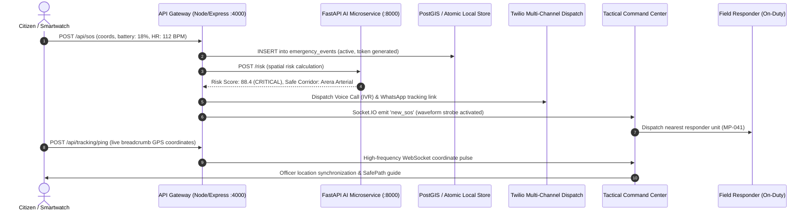
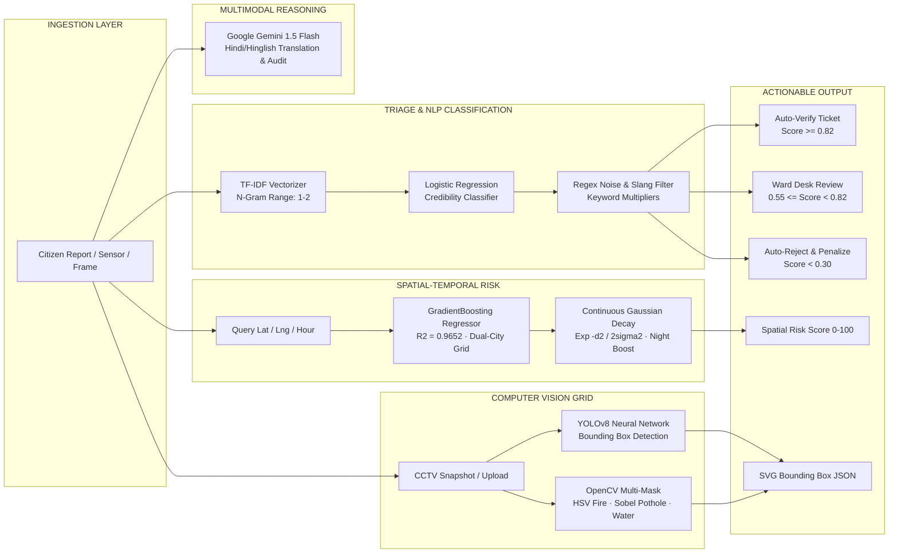
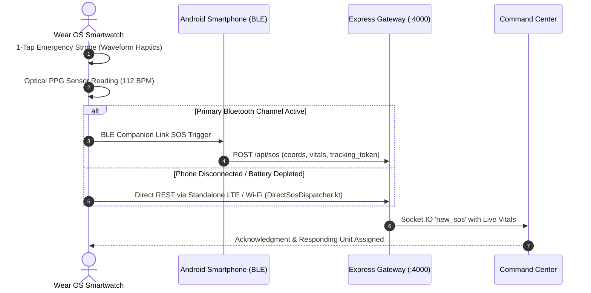
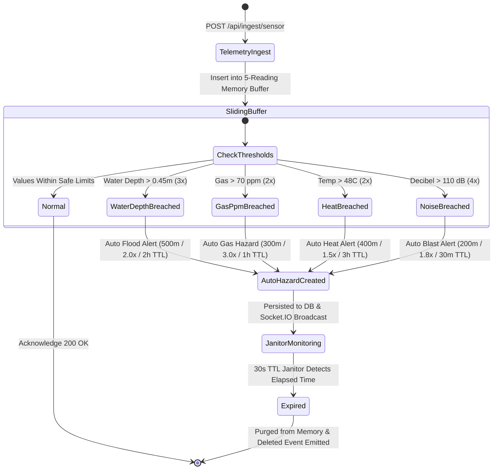
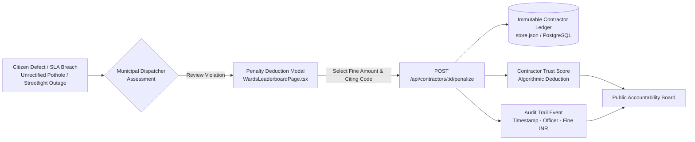
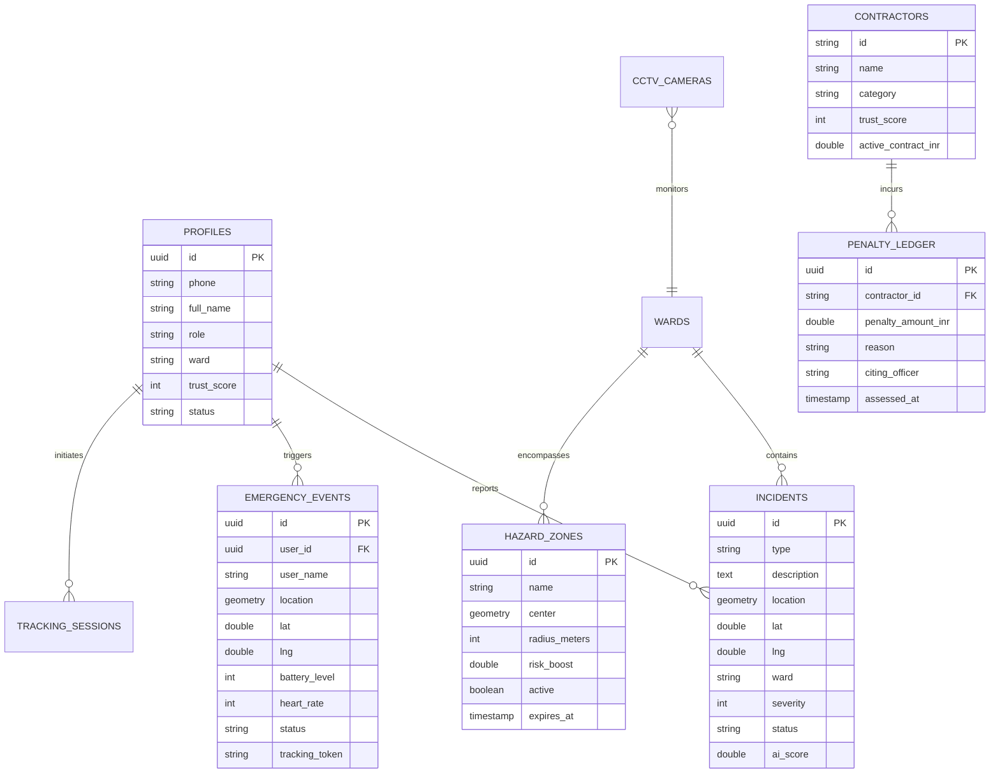

<div align="center">

# 🏛️ NAGARSETU V2.0
### Municipal Civic Intelligence & Tactical Command Operating System

<a href="https://git.io/typing-svg">
  
</a>

<p align="center">
  
  
  
  
  
  
  
  
  
  
  
  
  
</p>


</div>

> **NagarSetu V2.0** is an enterprise-grade civic governance, public safety, and smart city emergency command operating system.
> It unifies comprehensive municipal ward administration, real-time spatial citizen tracking, dynamic hazard geofencing, IoT environmental telemetry, automated contractor accountability ledgers, cross-border BIMSTEC legal intelligence, and an AI-driven CCTV computer vision grid into a resilient, high-availability municipal command platform.

---

## 📑 Table of Contents
1. [Executive Summary & Municipal Paradigm Shift](#1-executive-summary--municipal-paradigm-shift)
2. [Architectural Topology & Edge-to-Cloud Data Mesh](#2-architectural-topology--edge-to-cloud-data-mesh)
3. [Industry Benchmark & Comparative Superiority Matrix](#3-industry-benchmark--comparative-superiority-matrix)
4. [The 12-View Tactical Command Center](#4-the-12-view-tactical-command-center)
5. [Multi-Tier Machine Learning & AI Microservices](#5-multi-tier-machine-learning--ai-microservices)
6. [Native Mobile (13 Modules) & Wear OS Ecosystem](#6-native-mobile-13-modules--wear-os-ecosystem)
7. [Progressive Web App (PWA) Emergency Suite](#7-progressive-web-app-pwa-emergency-suite)
8. [Triple-Path Navigation & Safety Corridors](#8-triple-path-navigation--safety-corridors)
9. [IoT Environmental Telemetry & Escalation Pipeline](#9-iot-environmental-telemetry--escalation-pipeline)
10. [Contractor Accountability & Public Trust Ledger](#10-contractor-accountability--public-trust-ledger)
11. [DriveLegal: BIMSTEC Cross-Border Penal Code System](#11-drivelegal-bimstec-cross-border-penal-code-system)
12. [Enterprise Security, RBAC & Telephony Stack](#12-enterprise-security-rbac--telephony-stack)
13. [Unified PostGIS Schema & Resilient Hybrid Data Layer](#13-unified-postgis-schema--resilient-hybrid-data-layer)
14. [Production 5-Service Docker Composition & Gateway Network](#14-production-5-service-docker-composition--gateway-network)
15. [Comprehensive REST & WebSocket API Catalog](#15-comprehensive-rest--websocket-api-catalog)
16. [Automated Testing & City-Grid Simulation](#16-automated-testing--city-grid-simulation)
17. [Local Development & Deployment Handbook](#17-local-development--deployment-handbook)
18. [Security, Privacy, and Fail-Safe Ethics](#18-security-privacy-and-fail-safe-ethics)

---

## 1. Executive Summary & Municipal Paradigm Shift

### The Crisis in Municipal Urban Operations
Modern municipal corporations in developing metropolitan areas face four systemic failure modes:
1. **Departmental Information Silos**: Women's safety alerts (SOS), critical civil defense hazards (waterlogging, structural cave-ins, gas leaks), and ward budget allocations operate on disparate platforms with zero cross-departmental coordination.
2. **False Alarm & Spam Bottlenecks**: Up to 40% of incoming citizen reports represent duplicate submissions, low-resolution test queries, or false alarms. This floods field engineers, causing genuine crises to breach statutory 48-hour SLA deadlines.
3. **Blind Travel Routing**: Standard consumer mapping applications optimize solely for shortest distance or vehicle transit time, funneling pedestrians through unlit, isolated alleyways with elevated nocturnal crime risks.
4. **Contractor Impunity & Lack of Audit Trails**: Civil contractors frequently default on road maintenance and pothole repairs without transparent financial penalty mechanisms or persistent accountability records.

### The NagarSetu V2.0 Solution
NagarSetu V2.0 re-engineers municipal operations into a unified, proactive civic command operating system:
* **Deep Municipal Governance**: Native Android client (13 modules · 218 Kotlin files), municipal officer dispatch rosters, ward budget tracking, and an automated contractor penalty ledger.
* **Predictive Spatial-Temporal Safety**: Dual-city GradientBoosting ML regressor ($R^2 = 0.9652$) predicting risk scores across Bhopal and Indore with Gaussian spatial decay ($e^{-d^2/2\sigma^2}$) and nocturnal risk multipliers.
* **Autonomous Hazard Geofencing & IoT Pipeline**: Continuous hardware telemetry ingestion (water depth, gas fumes, acoustic decibels, ambient heat) with sliding-window validation triggering automatic hazard zones with background TTL expiration.
* **Tactical CCTV Vision Grid**: 6-feed real-time video surveillance wall running OpenCV and YOLOv8 computer vision models to identify potholes, waterlogging, crowd surges, and thermal fire signatures.
* **Cross-Border Legal Intelligence (DriveLegal)**: 154 indexed traffic and penal violations across 7 South Asian BIMSTEC nations with automated penalty calculations and bilingual Hinglish advisory.

---

## 2. Architectural Topology & Edge-to-Cloud Data Mesh

### System Topology Diagram

```mermaid
flowchart TD
    subgraph Edge Clients
        A[Android Native Client\n13 Modules · 218 Kotlin Files]
        B[Wear OS Smartwatch\nDirectSosDispatcher · Standalone LTE]
        C[3-Tap QR Emergency PWA\n/report/qr]
        D[PWA Fake Call Deterrent\n/report/qr/fake-call]
        E[Voice Safety Coach\n/report/qr/voice-coach]
        F[Browser Live Tracking Link\n/track/:token]
    end

    subgraph Edge Telemetry Grid
        IOT1[Ultrasonic Flood Sensors]
        IOT2[Electrochemical Gas Analyzers]
        IOT3[Acoustic Shock Microphones]
        CCTV_CAM[Tactical CCTV Video Feeds\n6x Channels · RTSP / MP4]
    end

    subgraph API Gateway & Event Mesh
        GW[Express.js & Socket.IO Gateway\nPort 4000 · Node 20 LTS]
        TWILIO[Twilio Voice IVR & WhatsApp\nMulti-Channel Dispatcher]
        JANITOR[Automated 30s TTL Janitor\nDynamic Hazard Cleanup]
    end

    subgraph AI Microservice Cluster
        FASTAPI[FastAPI Async Microservice\nPort 8000 · Uvicorn Engine]
        ML_RISK[Dual-City GradientBoosting\nR2 = 0.9652 · Sub-1ms Latency]
        ML_NLP[TF-IDF + Logistic Classifier\nAnti-Spam & Credibility Triage]
        CV_ENGINE[OpenCV & YOLOv8 Engine\nFrame Analysis & Bounding Boxes]
        LLM_CORE[Google Gemini 1.5 Flash\nMultilingual Multimodal Reasoning]
    end

    subgraph Enterprise Data Layer
        POSTGIS[(Supabase PostGIS Cluster\nMaster Spatial DB & GIST Indexes)]
        LOCAL_DB[(Atomic Local Disk Store\nbackend/data/store.json)]
        BIMSTEC_KB[(BIMSTEC Legal Database\n154 Violations · 7 Nations)]
        LEDGER[(Contractor Trust Ledger\nImmutable Penalty Audit Trail)]
    end

    subgraph Tactical Command Center
        UI[Next.js 15 App Router Dashboard\n12 Command & Tactical Views]
    end

    A -->|Reports, SOS & Telemetry| GW
    B -->|Bypass / Direct REST| GW
    C & D & E & F -->|REST / WebSocket| GW
    IOT1 & IOT2 & IOT3 -->|POST /api/ingest/sensor| GW
    CCTV_CAM -->|Video Stream & Frame Ingest| GW

    GW <--> POSTGIS
    GW <--> LOCAL_DB
    GW <--> BIMSTEC_KB
    GW <--> LEDGER
    GW <--> JANITOR

    GW <-->|HTTP Connection Pool| FASTAPI
    FASTAPI --> ML_RISK
    FASTAPI --> ML_NLP
    FASTAPI --> CV_ENGINE
    FASTAPI --> LLM_CORE

    GW -->|Voice Calls & WhatsApp Alerts| TWILIO
    GW <-->|Socket.IO Bidirectional Mesh| UI
```


### Real-Time Emergency Event Lifecycle & Auto-Escalation


---

## 3. Industry Benchmark & Comparative Superiority Matrix

The following architectural comparison demonstrates how NagarSetu V2.0 supersedes legacy municipal systems, single-purpose emergency apps, and conventional surveillance networks:

| Architectural Dimension | Legacy Municipal Portals (e.g. CPGRAMS) | Standalone Emergency SOS Apps | Traditional CCTV NVR Systems | **NagarSetu V2.0 (Unified Intelligent Platform)** |
|---|---|---|---|---|
| **Frontend Architecture** | Monolithic server-rendered HTML forms with full-page refreshes | Basic consumer mobile-first UI lacking municipal dispatch panels | Proprietary desktop NVR client bound to local subnets | **Next.js 15 App Router + React 19 + Tailwind CSS**, 12 dedicated municipal views, tactical glassmorphism, instant Light/Dark mode. |
| **Data Persistence & Spatial Integrity** | Relational SQL lacking spatial GIST indexes; table-lock bottlenecks | Standalone local SQLite with zero multi-agency synchronization | Disjointed proprietary video archives without GIS coordinate bindings | **Dual-Engine Spatial Fabric**: Cloud Supabase PostGIS 16 + atomic local disk store (`store.json`) with automated write-locks and zero data loss. |
| **Spatial-Temporal AI Risk** | Static manual priority rules without predictive spatial regression | Isolated offline scripts restricted to single pre-computed regions | None; purely reactive human monitor observation | **Dual-City GradientBoosting Regressor ($R^2 = 0.9652$)** trained on 2,040+ geocoded incidents across Bhopal & Indore with continuous Gaussian decay ($e^{-d^2/2\sigma^2}$). |
| **Incident Triage & Anti-Spam** | 100% manual triage; 48h to 72h ticket resolution backlog | None; unverified raw text dispatches to emergency call centers | None | **Scikit-Learn TF-IDF + Logistic Classifier + Heuristic Regex Filter**, sub-millisecond classification with automated dispatch tiers. |
| **Multimodal Civic Reasoning** | None | None | None | **Google Gemini 1.5 Flash Core** for multimodal photo validation and multilingual understanding in Hindi, Hinglish, and English. |
| **CCTV Computer Vision** | None | None | Basic hardware motion detection generating frequent false alarms | **Tactical 6-Feed Vision Wall** with real-time OpenCV & YOLOv8 bounding box detection (`pothole`, `waterlogging`, `crowd_surge`, `fire`). |
| **Hazard Geofencing** | Static municipal bulletins published days after incident occurrence | Fixed circular markers without automated lifecycle management | None | **Dynamic Danger Zones with 30s TTL Janitor**, custom radii ($50\text{m} - 1000\text{m}$), automated citizen proximity broadcast alerts. |
| **IoT Environmental Telemetry** | Completely manual; reports filed hours after floodwaters rise | None | None | **Hardware Ingestion Engine (`/api/ingest/sensor`)** with 5-reading sliding-window buffer triggering automated hazard zones for flood, gas, and heat. |
| **Triple-Path Navigation** | Linear coordinate interpolation or standard distance routing | Shortest-path routing funneling users through unlit backstreets | None | **Triple-Path Engine**: Fastest Route (Dijkstra/OSRM), Safest Route (Main-Road Arterial Bias + 95% illumination), and Green Eco Route (BRTS bus corridor). |
| **Contractor Accountability** | Hidden municipal files; manual fine assessments prone to corruption | None | None | **Public Contractor Trust Ledger**: Real-time reliability rating, financial penalty deduction modal, and immutable audit trail. |
| **Cross-Border Legal System** | Local municipal bylaws only; no cross-jurisdiction legal reference | None | None | **DriveLegal BIMSTEC Engine**: 154 indexed traffic and penal violations across 7 South Asian nations with repeat offender multipliers and Hinglish query bot. |
| **Mobile & Wearable Ecosystem** | Mobile web wrapper or unmaintained single-module application | Basic single-screen mobile application | None | **13-Module Android Architecture (218 Kotlin files)** + **Wear OS Smartwatch Siren (`DirectSosDispatcher`)** with standalone LTE/Wi-Fi failover. |

---

## 4. The 12-View Tactical Command Center

The administrative command center is engineered in **Next.js 15**, **React 19**, and **Tailwind CSS**, delivering 12 tactical views accessible via the persistent command sidebar:

```
frontend/src/components/pages/
├── DashboardOverviewPage.tsx   ← 6-card KPI grid, live activity feed & civil defense broadcast
├── SosPage.tsx                 ← High-contrast SOS triage, battery/heart rate vitals & SMS dispatch
├── LiveGisMapPage.tsx          ← Dual-city GIS map (Bhopal/Indore) + indoor blueprint overlays
├── SurveillancePage.tsx        ← 6-camera CCTV vision wall with live streams & YOLOv8 bounding boxes
├── HazardsPage.tsx             ← Dynamic geofenced danger zones with automated TTL countdown
├── IncidentsPage.tsx           ← Bulk-action triage data table with multi-attribute filtering
├── AnalyticsPage.tsx           ← Citywide macro benchmarks, 48h SLA breach tracker & budget charts
├── WardsLeaderboardPage.tsx    ← Ward rankings, officer dispatch roster & contractor penalty ledger
├── CitizenRegistryPage.tsx     ← Citizen trust scoring (0-100%), report audit & anti-fraud tools
├── DriveLegalPage.tsx          ← BIMSTEC legal explorer across 7 nations with fine calculator
├── NotificationsHubPage.tsx    ← Channel-separated notification feeds with tab synchronization
└── SettingsPage.tsx            ← Cloud toggles, AI sensitivity thresholds & mobile APK status
```

### Command Center Operational Navigation Graph

```mermaid
flowchart TD
    ROOT[Tactical Command Center\nNext.js 15 App Router]
    
    subgraph COMMAND SECTION
        V1[1. Municipal Overview\n6 KPI Cards · Live Event Feed · Area Broadcast]
        V2[2. SOS Monitor\nPanic Triage · Biometric Vitals · 1-Tap Tracking Link]
        V3[3. Live GIS Tactical Map\nDual-City Bounds · 4 Layers · Indoor Blueprints]
    end
    
    subgraph TACTICAL INTELLIGENCE
        V4[4. CCTV Vision Wall\n6x Video Streams · YOLOv8 Overlays · Snapshot Analysis]
        V5[5. Hazard Geofences\nDynamic Danger Zones · 30s TTL Clocks · Proximity Alerts]
    end
    
    subgraph MUNICIPAL OPERATIONS
        V6[6. Incidents & AI Triage\nBulk Action Bar · Multi-Attribute Filter · Confidence]
        V7[7. Analytics & SLA Trends\nMacro KPIs · 48h Breach Tracker · Budget Comparison]
        V8[8. Ward & Officer Board\nWard Trophies · Dispatch Roster · Contractor Ledger]
        V9[9. Citizen Trust Registry\nReliability 0-100% · Audit Log · Moderation Tools]
        V10[10. DriveLegal BIMSTEC\n154 Violations · 7 Nations · Hinglish Query Bot]
    end
    
    subgraph SYSTEM CONTROL
        V11[11. Notifications Hub\nChannel Filters · Cross-Tab Socket Sync]
        V12[12. Settings & System APIs\nCloud PostGIS Toggle · AI Thresholds · APK Bridge]
    end

    ROOT --> V1 & V2 & V3
    ROOT --> V4 & V5
    ROOT --> V6 & V7 & V8 & V9 & V10
    ROOT --> V11 & V12
```


### Detailed Breakdown of Views:
1. **Municipal Overview (`DashboardOverviewPage`)**:
   - Signature 6-Card KPI Grid: Real-time counters displaying Active SOS Beacons, Pending Triage Complaints, Verified Incidents, Rejected Tickets, Sanctioned Ward Budget Spent, and Active On-Duty Responders.
   - Live Emergency Feed: Real-time event ticker streaming SOS triggers, AI triage determinations, and officer assignments.
   - Ward Load Distribution: Visual progress breakdown of pending municipal complaints across Wards 1 through 85.
   - Area Broadcast Modal: Allows dispatchers to issue geo-targeted civil defense push alerts and SMS broadcasts to citizens within specific wards or citywide.

2. **SOS Operations Monitor (`SosPage`)**:
   - High-Contrast Panic Triage: Immediate visual prioritization of emergency beacons (`CRITICAL`, `HIGH`, `MODERATE`).
   - Live Biometric & Hardware Telemetry: Real-time rendering of victim battery percentage (`🔋 18%`) and wearable heart rate (`❤️ 112 BPM`).
   - One-Tap Public Tracking Link: Dispatches a cryptographically secure browser live-tracking link (`/track/:token`) via Twilio SMS.
   - Multi-Responder Dispatcher: Instant assignment of the nearest municipal police, ambulance, or disaster response vehicle.

3. **Tactical GIS Map (`LiveGisMapPage`)**:
   - Dual-City Footprint Switcher: Seamlessly toggles map bounds between **Bhopal Central** (`23.2599°N, 77.4126°E`) and **Indore SmartCity** (`22.7196°N, 75.8577°E`).
   - 4-Mode Tactical Layer Selector: `📍 Incidents`, `🚨 SOS Live`, `🌡️ Risk Heatmap`, and `🗺️ All Composite Layers`.
   - Indoor Floorplan Blueprint Overlays: Integrated Leaflet `L.imageOverlay` rendering architectural emergency blueprints for critical public facilities:
     * **Habibganj Railway Station** (Ground Floor & Concourse Level 1)
     * **AIIMS Bhopal Hospital Campus** (Emergency Wing & Trauma Center Level 0)
   - Quick Ward Fly-To Sidebar: Direct camera transit to high-density administrative wards.

4. **CCTV Vision Wall (`SurveillancePage`)**:
   - Zero-Scroll 6-Feed Camera Grid: Simultaneous video monitoring across 6 high-priority traffic and pedestrian intersections (`cam-01.mp4` through `cam-06.mp4`).
   - Real-Time YOLOv8 Bounding Box Overlays: Dynamic SVG/Canvas detection overlays identifying potholes, waterlogging, crowd surges, and stalled vehicles.
   - Camera Telemetry Badges: Displays stream resolution (`1080p` / `4K`), frame rate (`28-30 FPS`), and active alert classifications.
   - Live Frame Analysis: One-click frame capture dispatching base64 snapshots to `/api/cctv/:id/analyze-frame` for immediate computer vision triage.

5. **Hazard Geofences (`HazardsPage`)**:
   - Dynamic Danger Circles: Interactive creation of spatial hazard zones with custom radius sliders ($50\text{m} - 1000\text{m}$) and risk multipliers ($+10\% - +50\%$).
   - Automated TTL Countdown Clocks: Real-time countdown meters reflecting remaining lifespan before automated expiration.
   - Emergency Quick Presets: Instant one-click generation for Flash Flood Alerts, Civil Protests, Toxic Gas Leaks, and Road Cave-Ins.

6. **Incidents & AI Triage (`IncidentsPage`)**:
   - Bulk Operation Action Bar: Multi-select incident rows to trigger `✅ Verify Selected`, `❌ Reject Selected`, or `👤 Batch Assign Officer`.
   - Multi-Attribute Filter Engine: Instant search by incident keyword, resolution status (`pending`, `verified`, `rejected`, `resolved`), ward number, and severity level ($1 - 5$).
   - AI Confidence Progress Indicators: Real-time visual display of Scikit-Learn credibility scores and citizen reliability ratings.

7. **Ward Analytics & SLA Trends (`AnalyticsPage`)**:
   - Citywide Macro Metrics: Composite complaint resolution percentages, average response times, and statutory SLA compliance rates.
   - 48-Hour SLA Breach Tracker: Visual monitoring of tickets nearing or exceeding statutory municipal response deadlines.
   - Budget Utilization Analysis: Comparative bar charts illustrating sanctioned municipal funds versus contractor expenditures per ward.

8. **Ward Leaderboard & Contractor Accountability (`WardsLeaderboardPage`)**:
   - Ward Performance Leaderboard: Ranking of municipal wards by resolution efficiency with gold, silver, and bronze accolades.
   - Officer Dispatch Roster: Active field responder units with real-time status (`ON_DUTY`, `DISPATCHED`, `OFF_DUTY`).
   - Contractor Accountability Public Ledger:
     * Displays registered infrastructure contractors (e.g., *Madhya Pradesh Road Development Corp*, *Bhopal Municipal Water Works*).
     * Real-time reliability rating ($0\% - 100\%$) and active contract valuation.
     * **Penalty Deduction Modal**: Dispatchers can assess monetary fines against non-compliant contractors, immediately recording penalties into the immutable audit ledger.

9. **Citizen Trust Registry (`CitizenRegistryPage`)**:
   - Algorithmic Citizen Scoring: Reliability scores calculated based on historical report accuracy, verified submissions, and spam attempt ratios.
   - Account Moderation Suite: Instant administrative actions to `Verify & Activate`, `Flag for Audit`, or `Ban User` to preserve system integrity.

10. **DriveLegal BIMSTEC Law Explorer (`DriveLegalPage`)**:
    - Cross-Border Legal Intelligence: Comprehensive catalog of **154 traffic and penal code violations** across **7 South Asian BIMSTEC nations**: India (Motor Vehicles Act 2019 / BNS 2023), Bangladesh, Bhutan, Myanmar, Nepal, Sri Lanka, and Thailand.
    - Automated Penalty Calculator: Calculates monetary fines (with repeat offender $3\times$ multipliers, commercial vehicle penalties, and school zone surcharges).
    - Bilingual AI Query Bot: Hinglish natural language query engine (e.g., *"Bina helmet ke pakde gaye to kitna fine lagega?"*) returning exact section citations and citizen rights.

11. **Notifications Hub (`NotificationsHubPage`)**:
    - Channel-Separated Notification Streams: Filter by `All Channels`, `🚨 SOS Alerts`, `📋 Incidents`, `⚠️ Hazard Warnings`, and `⚙️ System Operations`.
    - Cross-Tab Synchronization: Real-time unread counter synchronizing automatically across all active browser sessions via WebSockets.

12. **Settings & System Configuration (`SettingsPage`)**:
    - Cloud & Hybrid Engine Toggles: Seamlessly toggle between Supabase PostGIS cloud clustering and local disk persistence mode.
    - AI Sensitivity Calibration: Sliders for automated verification ($\ge 0.82$) and automated rejection ($< 0.30$) thresholds.
    - Native Mobile & Wear OS Integration Status: Live bridge telemetry for Android APK and Wear OS smartwatch connectivity.

---

## 5. Multi-Tier Machine Learning & AI Microservices

The AI intelligence layer is deployed as a high-throughput **FastAPI microservice** (`ai_engine/server.py`) running on port `8000`, backed by trained Scikit-Learn models and Google Gemini 1.5 Flash:

### AI Microservice Inference Pipeline


### A. Mathematical Formulation: Spatial-Temporal Gaussian Risk
The continuous risk intensity $R(x, y, t)$ at query coordinate $(x, y)$ at time of day $t$ is formulated as:
$$R(x, y, t) = \min\left(100, \;\sum_{i=1}^{N} w_i \cdot \exp\left(-\frac{d( (x,y), (x_i,y_i) )^2}{2\sigma^2}\right) \cdot \gamma_{\text{night}}(t) + \epsilon\right)$$

Where:
* $d((x,y), (x_i,y_i))$ is the Great-Circle Haversine distance in kilometers:
  $$d = 2R \arcsin\left(\sqrt{\sin^2\left(\frac{\Delta \phi}{2}\right) + \cos\phi_1\cos\phi_2\sin^2\left(\frac{\Delta \lambda}{2}\right)}\right)$$
* $\sigma = 0.8\text{ km}$ represents the Gaussian spatial decay bandwidth.
* $w_i \in [1.0, 5.0]$ represents the severity weight of incident $i$, amplified by category multipliers (e.g., Assault/Harassment $= 1.5\times$, Flood $= 1.3\times$, Cave-in $= 1.4\times$).
* $\gamma_{\text{night}}(t)$ is the diurnal nocturnal risk multiplier:
  $$\gamma_{\text{night}}(t) = \begin{cases} 1.4 & \text{if } t \ge 20 \text{ or } t \le 4 \\ 1.0 & \text{otherwise} \end{cases}$$
* $\epsilon$ represents the ambient baseline urban risk factor ($\epsilon = 5.0$).

### B. Dual-City Scikit-Learn GradientBoosting Regressor
* **Model Pipeline**: `sklearn.ensemble.GradientBoostingRegressor` wrapped in a `StandardScaler`.
* **Training Dataset**: `master_crime_risk.csv` comprising 2,040+ geocoded historical incidents, intersection crime records, and environmental risk points across Bhopal and Indore.
* **Performance Metrics**:
  * **Coefficient of Determination ($R^2$)**: **0.9652**
  * **Mean Squared Error (MSE)**: **2.14**
  * **Inference Latency**: **$< 1.0\text{ ms}$** per spatial coordinate query.

### C. TF-IDF Credibility & Anti-Spam Classifier
* **Vectorization & Classification**: `TfidfVectorizer(ngram_range=(1, 2))` paired with `LogisticRegression(C=1.0)`.
* **Multi-Layer Heuristic Engine**:
  * **High-Risk Keywords**: Matching critical vocabulary (`weapon`, `pothole`, `accident`, `electrocution`, `waterlogging`, `khatra`, `gas leak`).
  * **Spam & Doubt Penalties**: Penalizes uncertain phrasing (`not sure`, `test`, `demo`, `just checking`).
  * **Regex Noise Suppression**: Filters character repetitions, keyboard mash patterns, and sample strings.
* **Automated Decision Tiers**:
  * $\text{Confidence} \ge 0.82 \implies \textbf{auto\_verify}$ (Immediate field responder dispatch).
  * $0.55 \le \text{Confidence} < 0.82 \implies \textbf{manual\_review}$ (Assigned to municipal ward desk).
  * $0.30 \le \text{Confidence} < 0.55 \implies \textbf{flag\_for\_review}$ (Requires secondary photo verification).
  * $\text{Confidence} < 0.30 \implies \textbf{auto\_reject}$ (Marked rejected, citizen trust score deducted).

### D. Google Gemini 1.5 Flash Multimodal Reasoning
* **Multilingual Translation & Dialect Normalization**: Translates citizen reports submitted in conversational Hindi or Hinglish (e.g., *"Yahan sadak par bahut bada gaddha hai paani bhara hua hai"*) into standardized English municipal summaries.
* **Multimodal Visual Proof Verification**: Accepts base64 citizen photograph uploads, performing image content validation to ensure uploaded images depict genuine infrastructure defects rather than stock photography or irrelevant media.

### E. OpenCV & YOLOv8 Hybrid Computer Vision Pipeline
* **Model Bindings**: Native integration of OpenCV (`cv2`) with YOLOv8 neural network weights (`best.pt`, `yolov8n.pt`).
* **Multi-Feature Hazard Extraction**:
  * **Thermal / Fire Detection**: HSV color space thresholding ($H \in [18, 35], S \in [140, 255], V \in [200, 255]$) isolating flame centroids.
  * **Waterlogging Analysis**: Adaptive grayscale thresholding and morphological closing operations identifying reflective water pooling on asphalt.
  * **Pothole Detection**: Sobel gradient magnitude edge detection identifying structural depressions in asphalt road networks.

---

## 6. Native Mobile (13 Modules) & Wear OS Ecosystem

### Android Native Architecture (218 Kotlin Files)
The production Android application is organized into 13 modular Gradle packages under `android/`:

```
android/
├── app/                  ← Application entrypoint, Hilt Dependency Injection, Root NavGraph
├── core/
│   ├── model/            ← Immutable domain entities (Incident, SosEvent, Ward, UserProfile)
│   ├── database/         ← Room local database, DAOs, Room migration specifications
│   ├── network/          ← Retrofit 2 + OkHttp 4 client, PostGIS REST bridge & token interceptors
│   └── datastore/        ← Jetpack DataStore for user preferences, JWT session persistence
├── feature/
│   ├── auth/             ← Citizen mobile authentication, OTP verification, biometric login
│   ├── dashboard/        ← Municipal citizen home screen, active tracking status, announcements
│   ├── reporting/        ← Camera capture, GPS geotagging, compressed multi-part photo upload
│   ├── tracking/         ← SafePath background location service, Fake Call deterrent screen
│   ├── sos/              ← Single-tap SOS siren trigger, emergency contact telephony integration
│   ├── navigation/       ← MapLibre / Mapbox triple-path turn-by-turn navigation
│   └── admin/            ← Municipal field officer dispatch dashboard, ticket resolution tools
└── wear/                 ← Wear OS Smartwatch companion application
```

### Wear OS Dual-Path Direct Dispatcher Architecture


---

## 7. Progressive Web App (PWA) Emergency Suite

To ensure zero-barrier emergency access for citizens without native mobile installations, NagarSetu V2.0 provides an optimized Progressive Web App suite:

```
frontend/src/app/report/qr/
├── page.tsx              ← 3-Tap Rapid Emergency QR Citizen Portal
├── fake-call/page.tsx    ← Interactive PWA Fake Call Deterrent Screen
└── voice-coach/page.tsx  ← Audio-guided pedestrian safety coaching system
```

1. **3-Tap Emergency QR Web App (`/report/qr`)**:
   - Zero-installation progressive web portal accessed via street-pole QR codes.
   - 3-tap rapid incident reporting with instant HTML5 GPS geolocation capture.
2. **PWA Fake Call Deterrent (`/report/qr/fake-call`)**:
   - Realistic incoming phone call screen designed to deter potential harassers during night transit.
   - Custom caller profiles ("Mom", "Inspector Sharma", "Colleague"), authentic audio ringtones, vibrational haptics, and a functional conversation timer.
3. **Voice Safety Coach (`/report/qr/voice-coach`)**:
   - Turn-by-turn audio companion providing reassuring verbal navigation instructions and safe corridor guidance during late-night pedestrian transit.
4. **Public Zero-Install Live Tracking (`/track/:token`)**:
   - Real-time Leaflet map interface accessed by emergency contacts via SMS links.
   - Displays real-time GPS breadcrumbs, victim battery level, and moving responder units without requiring an account or app download.

---

## 8. Triple-Path Navigation & Safety Corridors

The navigation engine evaluates three distinct route alternatives across road graph topologies:

```mermaid
flowchart TD
    START([User Start Coordinates]) --> ROUTER{Triple-Path Engine\nlocalRouter.js / OSRM}
    
    ROUTER -->|Fastest Path| PATH1[1. FASTEST ROUTE\nTravel Distance: 3.4 km · Travel Time: 8 min\nOptimizes purely for minimal transit duration\nSafety Score: 68/100]
    
    ROUTER -->|Main-Road Bias| PATH2[2. SAFEST ROUTE (Arterial Corridor)\nTravel Distance: 3.9 km · Travel Time: 10 min\nSnaps to 95%+ illuminated arterial avenues\nAI Risk Regressor Validated\nSafety Score: 94/100]
    
    ROUTER -->|Eco BRTS Corridor| PATH3[3. GREEN ECO ROUTE\nTravel Distance: 3.6 km · Carbon: 15g CO2\nIntegrates Bhopal City Link BRTS Bus Lanes\nSafety Score: 82/100]

    PATH1 --> DEST([Trip Destination])
    PATH2 --> DEST
    PATH3 --> DEST
```

---

## 9. IoT Environmental Telemetry & Escalation Pipeline

Deployed in `backend/src/routes/sensors.js`, hardware telemetry is continuously ingested via `POST /api/ingest/sensor`:

### Sliding-Window Escalation State Machine


### Automated Sensor Escalation Thresholds Table
| Sensor Type | Escalation Threshold | Persistence Window | Automated Municipal Action | Geofence Radius | Risk Boost | Geofence TTL |
|---|---|---|---|---|---|---|
| **`water_depth`** | $> 0.45\text{ m}$ ($1.5\text{ ft}$) | 3 consecutive readings | Auto-create `Auto: Flood Alert [Ward]` | $500\text{ m}$ | $+20.0$ | 2 Hours |
| **`gas_ppm`** | $> 70\text{ ppm}$ | 2 consecutive readings | Auto-create `Auto: Gas Hazard [Ward]` | $300\text{ m}$ | $+30.0$ | 1 Hour |
| **`temperature`** | $> 48^\circ\text{C}$ ($118^\circ\text{F}$) | 2 consecutive readings | Auto-create `Auto: Extreme Heat [Ward]` | $400\text{ m}$ | $+15.0$ | 3 Hours |
| **`decibel`** | $> 110\text{ dB}$ | 4 consecutive readings | Auto-create `Auto: Noise/Blast Alert [Ward]` | $200\text{ m}$ | $+18.0$ | 30 Minutes |

---

## 10. Contractor Accountability & Public Trust Ledger

Engineered in `backend/src/routes/contractors.js` and rendered in `WardsLeaderboardPage.tsx`:

### Contractor Penalty Deduction & Audit Workflow


* **Registered Municipal Contractors**: Tracks contracting firms handling road resurfacing, drainage maintenance, streetlighting, and water distribution.
* **Algorithmic Trust Score ($0\% - 100\%$)**: Calculated based on completed projects, unresolved citizen defect reports, and statutory SLA compliance.
* **Penalty Assessment Modal**: Authorized dispatchers can assess monetary deductions against defaulting contractors for delayed pothole repairs or unrectified hazard conditions.
* **Immutable Public Audit Ledger**: Every assessed penalty is permanently recorded with timestamp, contractor ID, fine amount (INR), citing officer, and legal justification.

---

## 11. DriveLegal: BIMSTEC Cross-Border Penal Code System

Located in `backend/src/routes/legal.js` and `backend/data/bimstec_traffic_code.json`, DriveLegal indexes **154 legal violations across 7 South Asian nations**:

```mermaid
flowchart TD
    QUERY[Citizen Query / Violation Code\ne.g. Bina Helmet / Drunk Driving] --> ENGINE{BIMSTEC Legal Engine\n/api/legal}
    
    ENGINE --> N1[🇮🇳 India\nMVA 2019 / BNS 2023]
    ENGINE --> N2[🇧🇩 Bangladesh\nRoad Transport Act 2018]
    ENGINE --> N3[🇧🇹 Bhutan\nRoad Safety Act 2021]
    ENGINE --> N4[🇲🇲 Myanmar\nMotor Vehicle Law 2015]
    ENGINE --> N5[🇳🇵 Nepal\nMotor Vehicle Act 2049]
    ENGINE --> N6[🇱🇰 Sri Lanka\nMotor Traffic Act]
    ENGINE --> N7[🇹🇭 Thailand\nLand Traffic Act]

    N1 & N2 & N3 & N4 & N5 & N6 & N7 --> MULTIPLIER{Penalty Multiplier Calculator}

    MULTIPLIER -->|First Offense| BASE[Base Fine Amount]
    MULTIPLIER -->|Repeat Offense| REP[3x Repeat Offender Fine]
    MULTIPLIER -->|Commercial Transport| COMM[1.5x Heavy Vehicle Surcharge]
    MULTIPLIER -->|School / Hospital Zone| SCH[2.0x Protection Zone Surcharge]

    BASE & REP & COMM & SCH --> RESPONSE[Structured Legal Output\nSection Citation · Fine (INR/Local) · Citizen Rights]
```

---

## 12. Enterprise Security, RBAC & Telephony Stack

### Role-Based Access Control (RBAC) Hierarchy
Implemented in `backend/src/middleware/auth.js`, the platform enforces strict role privileges via signed JWT bearer tokens:

| Role Identifier | Permissions & Operational Scope |
|---|---|
| **`SUPER_ADMIN`** | Unrestricted access: Citywide broadcast dispatches, system configuration, contractor penalty ledger audits, user banning. |
| **`WARD_OFFICER`** | Ward-level administration: Verification/rejection of ward complaints, officer task assignments, local hazard zone creation. |
| **`DISPATCHER`** | Emergency command: SOS acknowledgment, responder unit routing, Twilio voice/SMS triggers, CCTV monitoring. |
| **`FIELD_ENGINEER`**| Mobile field access: Viewing assigned incident tickets, uploading completion proof photographs, resolving complaints. |

*Dynamic Bypass*: In offline demonstration environments, `DISABLE_AUTH=true` allows rapid evaluation without requiring authentication challenges.

### Multi-Channel Twilio Telephony Mesh
Engineered in `backend/src/services/twilio.js`:
* **Automated Voice Call (IVR)**: Places outbound automated phone calls to designated emergency contacts upon SOS activation with interactive DTMF menu acknowledgment.
* **WhatsApp Emergency Dispatch**: Pushes interactive WhatsApp alert messages containing GPS coordinates, victim name, and browser tracking links.
* **SMS Gateway**: Fallback E.164 cellular SMS transmission ensuring delivery on legacy mobile handsets.

---

## 13. Unified PostGIS Schema & Resilient Hybrid Data Layer

### Database Entity-Relationship Model


```sql
-- Enable PostGIS & UUID Extensions
CREATE EXTENSION IF NOT EXISTS "uuid-ossp";
CREATE EXTENSION IF NOT EXISTS "postgis";

-- 1. User Profiles & Responders
CREATE TABLE profiles (
    id UUID PRIMARY KEY DEFAULT uuid_generate_v4(),
    phone VARCHAR(20) UNIQUE NOT NULL,
    full_name VARCHAR(128) NOT NULL,
    role VARCHAR(32) DEFAULT 'citizen',
    ward VARCHAR(128),
    trust_score SMALLINT DEFAULT 100 CHECK (trust_score BETWEEN 0 AND 100),
    status VARCHAR(32) DEFAULT 'active',
    created_at TIMESTAMPTZ DEFAULT NOW()
);

-- 2. Municipal Incidents with PostGIS Spatial Coordinates
CREATE TABLE incidents (
    id UUID PRIMARY KEY DEFAULT uuid_generate_v4(),
    type VARCHAR(64) NOT NULL,
    description TEXT NOT NULL,
    location GEOMETRY(Point, 4326) NOT NULL,
    lat DOUBLE PRECISION NOT NULL,
    lng DOUBLE PRECISION NOT NULL,
    address TEXT,
    ward VARCHAR(128) NOT NULL,
    severity SMALLINT DEFAULT 3 CHECK (severity BETWEEN 1 AND 5),
    status VARCHAR(32) DEFAULT 'pending',
    photos TEXT[] DEFAULT '{}',
    ai_score DOUBLE PRECISION,
    ai_risk_level VARCHAR(32),
    assigned_officer VARCHAR(128),
    reported_by UUID REFERENCES profiles(id),
    reported_at TIMESTAMPTZ DEFAULT NOW(),
    resolved_at TIMESTAMPTZ
);

-- 3. Emergency SOS Events
CREATE TABLE emergency_events (
    id UUID PRIMARY KEY DEFAULT uuid_generate_v4(),
    user_id UUID REFERENCES profiles(id),
    user_name VARCHAR(128) NOT NULL,
    phone VARCHAR(20) NOT NULL,
    ward VARCHAR(128),
    location GEOMETRY(Point, 4326) NOT NULL,
    lat DOUBLE PRECISION NOT NULL,
    lng DOUBLE PRECISION NOT NULL,
    battery_level SMALLINT,
    heart_rate SMALLINT,
    status VARCHAR(32) DEFAULT 'active',
    tracking_token VARCHAR(64) UNIQUE NOT NULL,
    contacts TEXT[] DEFAULT '{}',
    siren_type VARCHAR(32) DEFAULT 'CRITICAL',
    triggered_at TIMESTAMPTZ DEFAULT NOW()
);

-- 4. Dynamic Hazard Geofences with Automated TTL
CREATE TABLE hazard_zones (
    id UUID PRIMARY KEY DEFAULT uuid_generate_v4(),
    name VARCHAR(128) NOT NULL,
    center GEOMETRY(Point, 4326) NOT NULL,
    lat DOUBLE PRECISION NOT NULL,
    lng DOUBLE PRECISION NOT NULL,
    radius_meters INTEGER DEFAULT 150,
    risk_boost DOUBLE PRECISION DEFAULT 25.0,
    active BOOLEAN DEFAULT TRUE,
    expires_at TIMESTAMPTZ NOT NULL,
    created_at TIMESTAMPTZ DEFAULT NOW()
);

-- 5. Tactical CCTV Cameras & Vision Telemetry
CREATE TABLE cctv_cameras (
    id VARCHAR(32) PRIMARY KEY,
    name VARCHAR(128) NOT NULL,
    ward VARCHAR(128) NOT NULL,
    location GEOMETRY(Point, 4326) NOT NULL,
    lat DOUBLE PRECISION NOT NULL,
    lng DOUBLE PRECISION NOT NULL,
    feed_url TEXT NOT NULL,
    status VARCHAR(32) DEFAULT 'online',
    fps SMALLINT DEFAULT 30,
    resolution VARCHAR(16) DEFAULT '1080p',
    active_threat VARCHAR(64),
    threat_confidence DOUBLE PRECISION DEFAULT 0.0,
    detections JSONB DEFAULT '[]'
);

-- High-Performance Spatial GIST Indexes
CREATE INDEX idx_incidents_location ON incidents USING GIST(location);
CREATE INDEX idx_emergency_location ON emergency_events USING GIST(location);
CREATE INDEX idx_hazard_center ON hazard_zones USING GIST(center);
CREATE INDEX idx_cctv_location ON cctv_cameras USING GIST(location);
```

### Automated 30-Second TTL Hazard Janitor
An active background timer runs every 30 seconds within `backend/src/routes/hazards.js`:
$$\text{Filter: } \text{expires\_at} \le \text{NOW}() \implies \text{active} = \text{false}$$
Expired hazard circles are automatically purged from memory, persisted to disk, and broadcast to all connected web clients via the `hazard:expired` WebSocket event.

---

## 14. Production 5-Service Docker Composition & Gateway Network

```mermaid
flowchart LR
    CLIENT[Citizen / Dispatcher Browser] -->|Port 80 / 443| NGINX[NGINX Gateway Proxy\nReverse Proxy & SSL Termination]
    
    subgraph DOCKER NETWORK (nagarsetu-net)
        NGINX -->|/ -> 3000| FRONTEND[Next.js 15 Command Center\nnagarsetu-frontend :3000]
        NGINX -->|/api -> 4000| BACKEND[Express.js & Socket.IO Gateway\nnagarsetu-backend :4000]
        BACKEND -->|Connection Pool| AI[FastAPI AI Microservice\nnagarsetu-ai-engine :8000]
        BACKEND -->|GIST Spatial Queries| DB[(PostgreSQL 16 + PostGIS\nnagarsetu-db :5432)]
    end
```

| Service Container | Internal Port | External Port | Functionality |
|---|---|---|---|
| `nagarsetu-frontend` | `3000` | `3000` | Next.js 15 Tactical Command Center |
| `nagarsetu-backend` | `4000` | `4000` | Express.js & Socket.IO API Gateway |
| `nagarsetu-ai-engine`| `8000` | `8000` | FastAPI Machine Learning Microservice |
| `nagarsetu-db` | `5432` | `5432` | PostgreSQL 16 + PostGIS Spatial Cluster |
| `nagarsetu-gateway` | `80` | `8080` | NGINX Reverse Proxy & SSL Termination |

---

## 15. Comprehensive REST & WebSocket API Catalog

### REST API Endpoints

| Route | Method | Payload / Query Parameters | Functional Description |
|---|---|---|---|
| `/api/sos` | `GET` | `?status=active` | Returns active emergency beacons with battery, heart rate, and contacts. |
| `/api/sos` | `POST` | `{ userId, userName, lat, lng, batteryLevel, heartRate, contacts }` | Triggers SOS event, sends Twilio voice/SMS, and emits WebSocket alert. |
| `/api/sos/:id` | `PATCH` | `{ status: "acknowledged" \| "resolved" }` | Updates SOS beacon status and deactivates sirens. |
| `/api/incidents` | `GET` | `?status=&ward=&severity=&limit=` | Fetches incidents with multi-attribute filtering. |
| `/api/incidents` | `POST` | `{ type, description, lat, lng, ward, severity }` | Submits report; triggers asynchronous Scikit-Learn AI verification. |
| `/api/incidents/:id` | `PATCH` | `{ status, assignedOfficer }` | Updates incident status (`verified`, `rejected`, `dispatched`, `resolved`). |
| `/api/tracking/start` | `POST` | `{ userId, userName, lat, lng, contacts }` | Creates tracking session and generates public tracking token. |
| `/api/tracking/ping` | `POST` | `{ sessionId, lat, lng, batteryLevel, heartRate }` | Appends real-time GPS breadcrumb to active session. |
| `/api/tracking/location` | `GET` | `?session_id=TRK001` | Public endpoint for emergency contacts to view real-time location. |
| `/api/cctv` | `GET` | None | Returns the Tactical 6-Camera Vision Wall telemetry and detections. |
| `/api/cctv/:id/analyze-frame` | `POST` | `{ imageBase64: "..." }` | Executes OpenCV/YOLOv8 vision analysis on an uploaded camera frame. |
| `/api/hazards` | `GET` | None | Retrieves all active temporary hazard geofences that have not expired. |
| `/api/hazards` | `POST` | `{ name, lat, lng, radiusMeters, riskBoost, durationMin }` | Creates dynamic danger circle with automated TTL. |
| `/api/hazards/:id` | `DELETE` | None | Manually terminates an active hazard geofence. |
| `/api/risk/heatmap` | `GET` | `?city=bhopal` or `?city=indore` | Computes Gaussian spatial risk matrix for heatmap rendering. |
| `/api/risk/point` | `POST` | `{ lat, lng, hour, day }` | Predicts continuous risk score using the GradientBoosting ML model. |
| `/api/routing/calculate-routes` | `POST` | `{ startLat, startLng, endLat, endLng, mode, timeHour }` | Returns Fastest, Safest (Main-Road), and Green Eco routes with waypoints. |
| `/api/routing/evaluate-safety` | `POST` | `{ waypoints: [{lat, lng}], hour }` | Evaluates safety along any custom path polyline using the AI engine. |
| `/api/ingest/sensor` | `POST` | `{ deviceId, type, value, unit, lat, lng, ward }` | Ingests IoT telemetry; triggers sliding-window automated escalation. |
| `/api/contractors` | `GET` | None | Returns list of registered infrastructure contractors and trust ratings. |
| `/api/contractors/:id/penalize` | `POST` | `{ amount, reason, citingOfficer }` | Assesses penalty fine against contractor and appends to audit ledger. |
| `/api/contractors/audit-trail` | `GET` | None | Retrieves immutable contractor penalty deduction history. |
| `/api/legal/violations` | `GET` | `?jurisdiction=India&search=` | Retrieves indexed traffic/penal violations from BIMSTEC database. |
| `/api/legal/calculate-fine` | `POST` | `{ violationCode, isRepeat, vehicleType, isSchoolZone }` | Calculates fine amount with applicable multipliers. |
| `/api/legal/query-bot` | `POST` | `{ query: "bina helmet fine" }` | Hinglish NLP query bot returning legal citations and citizen rights. |
| `/api/users` | `GET` | `?status=active` | Lists citizens from the Citizen Trust Registry. |
| `/api/users/:id/status` | `PATCH` | `{ status: "flagged" \| "banned" }` | Updates citizen reliability status. |
| `/api/wards` | `GET` | None | Returns municipal ward leaderboard, budget spent, and SLA compliance. |
| `/api/wards/officers` | `GET` | `?status=on-duty` | Lists active field officer dispatch roster and response times. |
| `/api/stats` | `GET` | None | Returns composite municipal KPIs for dashboard header. |
| `/api/auth/login` | `POST` | `{ phone, password }` | Authenticates user and returns signed JWT with RBAC role. |
| `/api/docs` | `GET` | None | Self-documenting API specification catalog. |

### WebSocket Real-Time Events (Socket.IO)

| Event Identifier | Direction | Payload Structure | Operational Trigger |
|---|---|---|---|
| `new_sos` | Server $\to$ Client | `SosEvent` | Emitted when an emergency panic beacon is triggered. |
| `sos:updated` | Server $\to$ Client | `SosEvent` | Emitted when an SOS is acknowledged or resolved. |
| `new_incident` | Server $\to$ Client | `Incident` | Emitted on new citizen complaint submission. |
| `incident:updated` | Server $\to$ Client | `Incident` | Emitted when a complaint is verified, rejected, or dispatched. |
| `hazard:created` | Server $\to$ Client | `HazardZone` | Emitted when a new hazard geofence is created. |
| `hazard:deleted` | Server $\to$ Client | `{ id: string }` | Emitted when a hazard geofence is deleted manually. |
| `hazard:expired` | Server $\to$ Client | `{ id: string }` | Emitted by the 30s TTL Janitor upon geofence expiration. |
| `hazard:auto_created` | Server $\to$ Client | `HazardZone` | Emitted when IoT sensor thresholds trigger an automated geofence. |
| `cctv:detection` | Server $\to$ Client | `{ cameraId, threat, confidence }` | Emitted when computer vision detects a hazard on a CCTV feed. |
| `tracking:<token>` | Server $\to$ Client | `{ lat, lng, batteryLevel, heartRate }` | High-frequency live GPS coordinate pulse for active sessions. |

---

## 16. Automated Testing & City-Grid Simulation

### Comprehensive API Test Suite (`backend/test/api.test.js`)
The repository includes a 30-case integration test suite validating every backend route and persistence mechanism:
```bash
cd backend
npm run test:api
```
*Validates health status, SOS beacon lifecycle, AI triage classifications, dynamic hazard TTL, Gaussian risk matrix generation, BIMSTEC legal calculators, and contractor penalty logging.*

### Async City-Grid Simulator (`scripts/simulate_city_grid.py`)
A continuous Python event simulator that injects realistic citywide load into the running platform:
```bash
python scripts/simulate_city_grid.py --interval 3.0 --city bhopal
```
*Simulates incoming citizen complaints, periodic SOS triggers with fluctuating vitals, and IoT sensor telemetry spikes (water depth and gas levels) to demonstrate real-time dashboard reactivity.*

---

## 17. Local Development & Deployment Handbook

### Prerequisites
* **Node.js**: v20+ LTS
* **Python**: v3.11+
* **Git**: Installed
* **Docker & Docker Compose**: (Optional, for containerized multi-service deployment)

---

### Step 1: Clone Repository
```bash
git clone https://github.com/yajatkataria08-a11y/NagarsetuV2.0.git
cd NagarsetuV2.0
```

### Step 2: Environment Configuration
Copy template environment files across services:
```bash
# Root Monorepo Configuration
cp .env.example .env

# Backend API Configuration
cp backend/.env.example backend/.env
```

### Step 3: Install Dependencies
```bash
# Install root workspaces dependencies
npm install

# Install frontend dependencies
cd frontend && npm install && cd ..

# Install backend dependencies
cd backend && npm install && cd ..

# Install Python AI dependencies
cd ai_engine && pip install -r requirements.txt && cd ..
```

### Step 4: Launch Development Services

**Option A: Unified Root Monorepo Runner (Recommended)**
```bash
npm run dev:all
```

**Option B: Independent Service Terminals**
```bash
# Terminal 1: FastAPI AI Microservice (Port 8000)
cd ai_engine
python server.py

# Terminal 2: Express.js & Socket.IO API Gateway (Port 4000)
cd backend
npm run dev

# Terminal 3: Next.js 15 Command Center (Port 3000)
cd frontend
npm run dev
```

*Access the Tactical Command Center at `http://localhost:3000`.*

---

### Step 5: Multi-Container Docker Composition
To orchestrate the complete 5-service production stack in Docker:
```bash
docker-compose up --build -d
```

---

## 18. Security, Privacy, and Fail-Safe Ethics

* **Zero-Knowledge Live Tracking**: Public tracking URLs (`/track/:token`) use high-entropy cryptographically generated 64-bit random tokens that automatically expire upon session termination.
* **Transient Geolocation Storage**: Breadcrumb coordinates are automatically purged from active tracking memory after 24 hours to prevent pattern-of-life surveillance.
* **Anti-Abuse Scoring**: False, duplicate, or malicious submissions are algorithmically penalized against citizen trust scores, preventing denial-of-service against emergency dispatchers.
* **Air-Gapped Resilient Failovers**: If cloud PostGIS clusters or remote AI endpoints become unreachable, the backend seamlessly degrades to local disk persistence and local in-memory heuristic verification without dropping a single citizen request.

---

<div align="center">
  
  <p><b>🏛️ NagarSetu V2.0 — Municipal Civic Intelligence & Tactical Command Operating System</b></p>
  <p><i>Engineered for safer, smarter, and more resilient municipal cities.</i></p>
</div>
