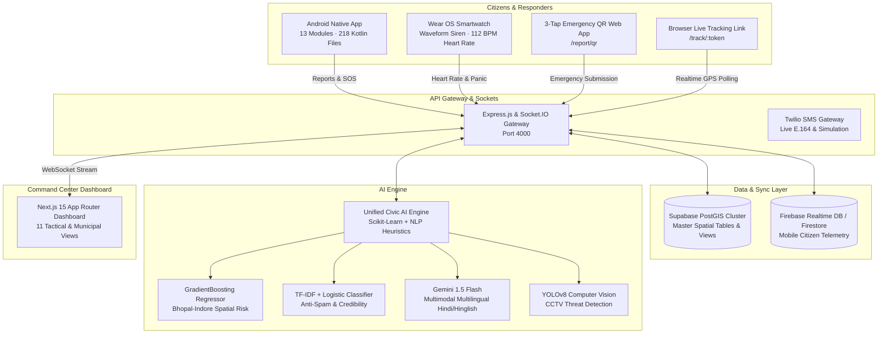

# 🏛️ NagarSetu V2.0 — Municipal Civic Intelligence & Tactical Command Center

[](https://nextjs.org/)
[](https://tailwindcss.com/)
[](https://nodejs.org/)
[](https://python.org/)
[](https://scikit-learn.org/)
[](https://deepmind.google/technologies/gemini/)
[](https://developer.android.com/)
[](https://developer.android.com/wear)
[](https://postgis.net/)

> **NagarSetu V2.0** unifies the deep municipal governance of **NagarSetu** (Bhopal & Indore Municipal Corporations), the peer-to-peer real-time tracking and dynamic hazard geofencing of **Raksha**, and the AI-driven zero-scroll CCTV vision wall of **Krisis** into a unified, mission-critical civic protection suite.

---

## 📑 Table of Contents
1. [Architectural Overview](#-architectural-overview)
2. [Complete 11-Page Municipal Dashboard](#-complete-11-page-municipal-dashboard)
3. [Merged AI Engine (Scikit-Learn + Gemini Flash + YOLOv8)](#-merged-ai-engine)
4. [Native Android & Wear OS Apps](#-native-android--wear-os-apps)
5. [Unified PostGIS Master Schema](#-unified-postgis-master-schema)
6. [Quick Start & Local Development](#-quick-start--local-development)
7. [API Specification](#-api-specification)
8. [Phase Completion Matrix](#-phase-completion-matrix)

---

## 🏛️ Architectural Overview



---

## 🖥️ Complete 11-Page Municipal Dashboard

The frontend has been built from scratch in **Next.js 15 (App Router)** and **Tailwind CSS**, discarding fragile monolithic HTML scripts in favor of modular React components and state management with persistent dark/light tactical themes:

| Module / View | Path | Description & Features |
|---|---|---|
| **1. Municipal Overview** | `dashboard` | Signature 6-card KPI grid (`🚨 Active SOS`, `⏳ Pending Triage`, `✅ Verified`, `❌ Rejected`, `💰 Spent Budget`, `👮 Responders`), live emergency feed, ward load list, and Area Broadcast modal. |
| **2. SOS Monitoring** | `sos` | Live triage queue for active beacons, victim vitals (`❤️ 112 BPM`, `🔋 Battery %`), contact dialers, one-click browser tracking link generation, and police/medical dispatch. |
| **3. Tactical GIS Map** | `map` | Dual-city switcher (**Bhopal Central** vs **Indore SmartCity**), 4-mode layer switcher (`📍 Incidents`, `🚨 SOS Live`, `🌡️ Risk Heat`, `🗺️ All Layers`), quick ward fly-to list, and floating stat pills. |
| **4. CCTV Vision Wall** | `surveillance` | **Krisis** 6-feed zero-scroll AI camera grid with YOLOv8 threat detections, live simulation feeds, bounding box highlights, and snapshot capture. |
| **5. Hazard Geofences** | `hazards` | **Raksha** dynamic danger zones with automated TTL expiration, radius sliders (50m–1000m), risk boosts, and citizen broadcast dispatch. |
| **6. Incidents & Triage** | `incidents` | Full municipal data table with multi-select checkboxes, bulk actions (`✅ Verify Selected`, `❌ Reject Selected`, `👤 Assign Officer`), multi-attribute filters, and AI score pills. |
| **7. Ward Analytics** | `analytics` | Macro-level municipal KPIs, complaint resolution ratios, SLA breach tracking (exceeding 48h windows), and budget utilization. |
| **8. Ward & Officer Board** | `wards` | Dual-column municipal leaderboard: Ward ranking sorted by resolution rate + active officer dispatch roster with response times. |
| **9. Citizen Trust Registry** | `users` | Citizen reliability scoring (0%–100%), total reports submitted, spam tracking, and moderation controls (`Verify`, `Flag`, `Ban`). |
| **10. Notifications Hub** | `notifications` | Tabbed inbox (`All`, `🚨 SOS`, `📋 Incidents`, `⚠️ Alerts`, `⚙️ System`), unread badges, "Mark All Read", and direct navigation links. |
| **11. System Configuration** | `settings` | Firebase RTDB & FCM sync, Supabase PostGIS connection, AI auto-verify/reject threshold sliders, and Android client bridge status. |

---

## 🧠 Merged AI Engine

Located in `ai_engine/unified_civic_ai.py`, the AI engine combines the best machine learning techniques from both projects:

1. **Scikit-Learn GradientBoosting Regressor (`models/risk_regressor.joblib`)**:
   - Continuous spatio-temporal risk mapping: `(lat, lng, hour, day_of_week) -> 0..100`.
   - Trained on historical crimes and verified citizen reports across Bhopal and Indore.
   - Smooth Gaussian continuous decay ($e^{-d^2 / 2\sigma^2}$) with a $1.4\times$ night-time multiplier ($20:00–04:00$).
2. **Scikit-Learn TF-IDF + NLP Credibility Classifier (`models/nlp_classifier.joblib`)**:
   - Merges NagarSetu's high-risk keyword dictionaries (`weapon`, `pothole`, `waterlogging`, `attack`, `electrocution`) and anti-spam regex filters (`/test/`, `/demo/`, repeated characters).
   - Generates confidence scores ($0.00$ to $1.00$) and recommends automated actions: `auto_verify` ($\ge 0.82$), `manual_review` ($0.55–0.81$), `flag_for_review` ($0.30–0.54$), or `auto_reject` ($< 0.30$).
3. **Google Gemini 1.5 Flash Multimodal (`gemini_civic_core.py`)**:
   - Real-time multimodal analysis of uploaded citizen photos.
   - Multilingual query understanding in **Hindi**, **Hinglish**, and **English**.
4. **YOLOv8 Computer Vision (`vision_service.py`)**:
   - Automated CCTV object and anomaly detection for road hazards, waterlogging, crowds, and smoke.

---

## 📱 Native Android & Wear OS Apps

All 218 Kotlin source files across 13 native Android modules are preserved and enhanced in `android/`:

- **Core Modules**: `:app`, `:core:model`, `:core:database`, `:core:network`, `:core:datastore`, `:feature:auth`, `:feature:dashboard`, `:feature:reporting`, `:feature:tracking`, `:feature:sos`, `:feature:navigation`, `:feature:admin`, `:wear`.
- **Raksha Deterrent Upgrades (`RakshaScreen.kt`)**:
  - Integrated **Fake Call Screen** (`FakeCallScreen.kt`) with realistic incoming caller UI, timer, and deterrent audio simulation.
  - One-tap browser live tracking link generation (`/track/:token`) for emergency contacts.
- **Wear OS Smartwatch Siren (`WatchMainActivity.kt`)**:
  - Full-screen high-contrast SOS activation.
  - Waveform haptic vibration siren.
  - Live heart rate sensor transmission (`❤️ 112 BPM`) over Bluetooth / HTTP.

---

## 🗄️ Unified PostGIS Master Schema

The unified database schema in `database/schema_master.sql` brings together all tables and spatial views:

```sql
-- Core Spatial Extensions
CREATE EXTENSION IF NOT EXISTS "uuid-ossp";
CREATE EXTENSION IF NOT EXISTS "postgis";

-- Incidents with AI Triage
CREATE TABLE incidents (
    id UUID PRIMARY KEY DEFAULT uuid_generate_v4(),
    type VARCHAR(64) NOT NULL,
    description TEXT,
    location GEOMETRY(Point, 4326) NOT NULL,
    lat DOUBLE PRECISION NOT NULL,
    lng DOUBLE PRECISION NOT NULL,
    ward VARCHAR(128),
    severity SMALLINT CHECK (severity BETWEEN 1 AND 5),
    status VARCHAR(32) DEFAULT 'pending',
    ai_score DOUBLE PRECISION,
    ai_risk_level VARCHAR(32),
    created_at TIMESTAMPTZ DEFAULT NOW()
);

-- Active SOS Events
CREATE TABLE emergency_events (
    id UUID PRIMARY KEY DEFAULT uuid_generate_v4(),
    user_id UUID NOT NULL,
    location GEOMETRY(Point, 4326) NOT NULL,
    lat DOUBLE PRECISION NOT NULL,
    lng DOUBLE PRECISION NOT NULL,
    battery_level SMALLINT,
    heart_rate SMALLINT,
    status VARCHAR(32) DEFAULT 'active',
    tracking_token VARCHAR(64) UNIQUE,
    created_at TIMESTAMPTZ DEFAULT NOW()
);

-- Raksha Dynamic Hazard Geofences with TTL
CREATE TABLE hazard_zones (
    id UUID PRIMARY KEY DEFAULT uuid_generate_v4(),
    name VARCHAR(128) NOT NULL,
    center GEOMETRY(Point, 4326) NOT NULL,
    lat DOUBLE PRECISION NOT NULL,
    lng DOUBLE PRECISION NOT NULL,
    radius_meters INTEGER DEFAULT 150,
    risk_boost DOUBLE PRECISION DEFAULT 25.0,
    expires_at TIMESTAMPTZ NOT NULL
);

-- Krisis 6-Camera Vision Feeds
CREATE TABLE cctv_cameras (
    id VARCHAR(32) PRIMARY KEY,
    name VARCHAR(128) NOT NULL,
    ward VARCHAR(128) NOT NULL,
    location GEOMETRY(Point, 4326) NOT NULL,
    feed_url TEXT NOT NULL,
    status VARCHAR(32) DEFAULT 'active',
    ai_detections JSONB DEFAULT '[]'
);
```

---

## 🚀 Quick Start & Local Development

### Prerequisites
- **Node.js**: v20+ LTS
- **Python**: v3.11+ (with `scikit-learn`, `numpy`, `pandas`, `joblib`)
- **Docker**: Optional (for containerized full-stack deployment)

### 1. Launch Next.js 15 Command Center
```bash
cd frontend
npm install
npm run dev
# Dashboard running at http://localhost:3000
```
> *The dashboard operates in mock/demo mode automatically if the backend is not running.*

### 2. Launch Express & Socket.IO API Gateway
```bash
cd backend
npm install
npm run dev
# API Gateway running at http://localhost:4000
```

### 3. Run or Retrain AI Engine
```bash
cd ai_engine
# Retrain Scikit-Learn Models
python unified_civic_ai.py train

# Verify Incident Report
python unified_civic_ai.py verify '{"description":"Huge pothole on TT Nagar bridge","severity":4}'

# Query Spatio-Temporal Risk
python unified_civic_ai.py risk '{"lat":23.2599,"lng":77.4126,"hour":22,"day":4}'
```

### 4. Full-Stack Docker Deployment
```bash
docker-compose up --build
```

---

## 📡 API Specification

| Endpoint | Method | Description |
|---|---|---|
| `/api/incidents` | `GET` | List civic incidents with status, ward, and severity filters. |
| `/api/incidents` | `POST` | Submit report; triggers automated Scikit-Learn AI triage. |
| `/api/sos` | `GET` | List active emergency beacons and responder statuses. |
| `/api/sos` | `POST` | Trigger SOS alert with vitals (`battery`, `heartRate`, `contacts`). |
| `/api/risk/heatmap` | `GET` | Spatio-temporal Gaussian risk grid (`?city=bhopal` or `?city=indore`). |
| `/api/risk/point` | `POST` | Point risk calculation using GradientBoosting ML model. |
| `/api/hazards` | `GET` / `POST` | Manage dynamic geofenced danger zones with automated TTL. |
| `/api/tracking/location` | `GET` / `POST` | Real-time GPS coordinates for active citizen tracking sessions. |
| `/api/routing/triple` | `POST` | Computes Fastest, Safest (Main-Road Bias), and Green routes. |

---

## 🏁 Phase Completion Matrix

- [x] **Phase 1: Multi-Repo Ingestion & Audit** — Ingested NagarSetu, Raksha, and Krisis.
- [x] **Phase 2: Master Database Schema** — Unified PostGIS schema and compatibility views.
- [x] **Phase 3: Backend API Gateway** — Express.js + Socket.IO with Supabase PostGIS sync.
- [x] **Phase 4: Frontend Foundation** — Next.js 15, App Router, Tailwind CSS, Lucide.
- [x] **Phase 5: SOS Command Operations** — Real-time beacons, vitals, dispatch controls.
- [x] **Phase 6: Tactical Map Integration** — Dual Bhopal/Indore GIS, Leaflet dark tiles, layers.
- [x] **Phase 7: Krisis CCTV Wall** — 6-camera zero-scroll grid with YOLOv8 threat badges.
- [x] **Phase 8: Raksha Hazard Geofences** — Dynamic danger zones with TTL expiration.
- [x] **Phase 9: Mobile App Upgrades** — 218 Kotlin files, Fake Call screen, live tracking links.
- [x] **Phase 10: Wear OS Smartwatch** — Waveform haptic siren, heart rate transmission.
- [x] **Phase 11: Scikit-Learn + NLP AI Core** — GradientBoosting regressor & TF-IDF classifier.
- [x] **Phase 12: Multimodal Gemini Reasoning** — Multilingual Hindi/Hinglish reasoning.
- [x] **Phase 13: Emergency QR & Web Tracking** — 3-tap emergency report & public tracking token.
- [x] **Phase 14: Municipal Governance Views** — Ward & officer leaderboard, citizen trust registry, settings.
- [x] **Phase 15: Production Hardening & Documentation** — Docker Compose, tests, architecture docs.

---

*Engineered with pride for smarter, safer municipal cities.*