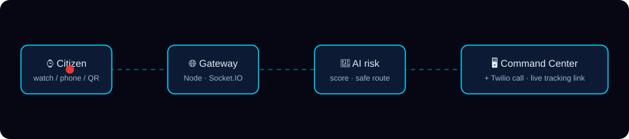
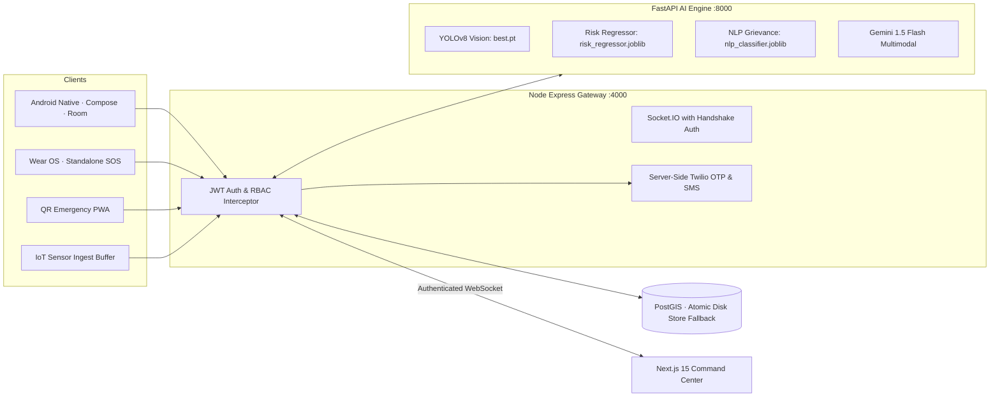

<div align="center">



<a href="https://git.io/typing-svg"></a>


[📘 Project Guide](PROJECT_GUIDE.md) · [🎤 5-min demo script](PROJECT_GUIDE.md#19-hackathon-5-minute-live-demonstration-script) · [🛠 API catalog](PROJECT_GUIDE.md#15-developer-api-reference-with-curl-examples)


</div>

---

## The problem

In an Indian city, a woman's SOS, a flooded underpass, a pothole a contractor was paid to fix, and a traffic fine are handled by four different systems — or none. Reports get lost, alerts reach nobody, and nobody is accountable.

## What NagarSetu does

It puts all of it into **one live loop**:

<p align="center"></p>

```
Citizen / Watch / Shake ──SOS──▶ Unified Gateway ──▶ AI Risk & Vision ──▶ Command Center (live)
                                      │                                        │
                                      ├─▶ Server-side Twilio Call + SMS        └─▶ Dispatch nearest responder
                                      ├─▶ Authenticated Socket.IO Broadcast
                                      └─▶ Live tracking link for family (returns real 404 on expire)
```

A tap on a watch, a violent shake of a phone, or a 1-tap notification tile becomes a flashing card on the municipal dashboard, a phone call to a responder, and a live-location link for family — in one request.

---

## Why it stands out

| | |
|---|---|
| 🛡️ **Safety-aware routing** | Three routes per trip — **Fastest**, **Balanced**, **Safest**. Safest minimizes `distance × (1 + 3·risk − 0.5·lighting)` over a Dijkstra road graph with OSRM fallback, so a woman walking at 10 pm isn't sent down the shortest dark alley. |
| 🧠 **Predictive risk model** | Trained gradient-boosting regressor (`risk_regressor.joblib`, $R^2 \approx 0.966$) scoring a 50×50 spatial grid across Bhopal and Indore, featuring night-time multipliers and Gaussian spatial decay. |
| 👁️ **YOLOv8 Computer Vision** | Shipped production neural weights (`best.pt`, 6.16 MB) detecting potholes, waterlogging, crowd surges, and stalled vehicles on CCTV camera streams and citizen photo uploads. |
| 📱 **Hardware Shake-to-SOS** | Background accelerometer sensor listener measuring dynamic jerk $|a_{\text{net}}| \ge 24\text{ m/s}^2$ across 3 rapid directional reversals with a 5s cooldown to eliminate false positives. |
| ⚡ **Quick Settings 1-Tap SOS** | Native Android `EmergencyTileService` in the notification shade, enabling 1-tap emergency dispatch even when the device is locked. |
| 🔊 **Geofence Proximity Radar (Voice TTS)** | Background `HazardProximityService` running Haversine distance checks against active hazard zones, triggering spoken audio alerts (*"Caution: Approaching active danger zone..."*) and siren haptics. |
| 💾 **Room Offline-First Queue Engine** | Encrypted SQLite storage (`PendingSosEntity` & `PendingReportEntity`) with an automated network callback worker that auto-syncs queued emergencies to the gateway the instant internet resumes. |
| 📡 **IoT → Hazard automation** | Telemetry ingestion endpoint (`/api/ingest/sensor`) with sliding-window buffers for flood/gas/temperature/decibels that automatically geofences and broadcasts danger zones on TTLs. |
| ⌚ **Works without the phone** | Wear OS app with a standalone SOS path (`DirectSosDispatcher`) that sends heart rate and battery with the alert and buzzes a haptic confirmation. |
| 📲 **Zero-install emergency PWA** | Scan a QR code → 3-tap SOS, fake incoming call deterrent, and voice safety coach. Works for people who never installed the app. |
| ⚖️ **DriveLegal** | 154 traffic violations across **7 BIMSTEC nations**, with repeat-offence multipliers and Hinglish queries. |
| 🧾 **Contractor accountability** | A ledger where penalties are deducted and logged to an audit trail, so repair promises have consequences. |
| 🖥️ **14-view command center** | SOS triage, GIS map, CCTV wall, hazards, incidents, analytics, ward leaderboard, citizen registry, notifications. |

---

## Architecture



**Resilience by design:**
- If PostGIS is unreachable, the gateway runs on an atomic disk store and keeps serving without interruption.
- If deep learning weights are unavailable, vision falls back to OpenCV HSV edge analysis and local NLP heuristics.
- If cellular internet drops, the Android client queues alerts in Room DB and broadcasts SMS fallbacks.

**Zero-Trust Security:**
- JWT authentication with 4 enforced RBAC roles (`SUPER_ADMIN`, `WARD_OFFICER`, `DISPATCHER`, `FIELD_ENGINEER`).
- Socket.IO handshakes strictly authenticated with token verification.
- Twilio & AI cloud API keys (Gemini/Groq) strictly isolated behind backend & AI microservices — zero secrets in client APKs or browser code.
- Real tracking endpoint returns strict `404 Not Found` for unverified sessions (zero simulated data leakage).
- Sensor telemetry protected with `x-sensor-api-key` validation and capped sliding windows.

---

## Production AI Models (Shipped in Repository)

All trained model weights and spatial index caches are pre-compiled and tracked directly in [`ai_engine/models/`](file:///d:/COODING/Projects/Hackathon/Nagarsetu/repo_v2/ai_engine/models/):

| Model Artifact | Type / Framework | Purpose | Metrics / Output |
| :--- | :--- | :--- | :--- |
| **`best.pt`** (6.16 MB) | **YOLOv8** (PyTorch) | Municipal hazard detection on CCTV feeds & photos | Potholes, waterlogging, crowd surges, stalled vehicles, accidents |
| **`risk_regressor.joblib`** (792 KB) | **GradientBoostingRegressor** | Dual-city spatio-temporal risk scoring | $R^2 = 0.9659$, $\text{MAE} = 1.70$ on held-out empirical split |
| **`spatial_risk_matrix.json`** (232 KB) | **50×50 Geo Cache** | Sub-millisecond (<5ms) corridor safety risk lookup | Pre-computed Gaussian decay grid for Bhopal & Indore |
| **`nlp_classifier.joblib`** (119 KB) | **TF-IDF + LogisticRegression** | Automatic citizen grievance triage | 6 municipal categories with department routing codes |

---

## By the numbers

| | |
|---|---|
| Android | **16 Gradle modules**, **229 files**, Shake-to-SOS, Quick Settings Tile, Room offline queue, TTS radar |
| Command center | **14** page views, Next.js 15 + React 19 + Tailwind CSS |
| Backend Gateway | **15 route groups**, Socket.IO realtime with handshake auth, Server-side Twilio OTP |
| AI Neural Suite | **3 production models shipped** (`best.pt`, `risk_regressor.joblib`, `nlp_classifier.joblib`) + Gemini 1.5 Flash |
| Legal dataset | **154 violations × 7 nations** (BIMSTEC regional harmonization) |
| Tests | **35-case** end-to-end API regression suite (`backend/test/api.test.js`) |
| Deploy | Docker Compose: NGINX gateway, Next.js frontend, Express backend, FastAPI AI engine, PostGIS |

---

## Try it in 3 minutes (no Docker needed)

```bash
git clone https://github.com/yajatkataria08-a11y/NagarsetuV2.0 && cd NagarsetuV2.0

# 1. Backend Gateway → http://localhost:4000
cd backend && cp .env.example .env && npm install && npm start

# 2. Seed realistic demo data (Bhopal + Indore)
node ../scripts/seed_demo.js

# 3. AI service → http://localhost:8000   (Pre-trained models load instantly)
cd ../ai_engine && pip install -r requirements.txt && python server.py

# 4. Command center → http://localhost:3000
cd ../frontend && npm install && npm run dev
```

Full stack with one command: `docker compose up --build`

**Run the tests:** with the backend running, `cd backend && npm test`.

### Judge walkthrough

1. Open the dashboard → **Overview** and **SOS** views.
2. From a phone, scan the **QR code** and trigger an SOS (or `POST /api/sos`).
3. Watch the card appear live via authenticated Socket.IO, then open the **tracking link** it generates.
4. Open **Surveillance / CCTV Wall** → view real-time streams with YOLOv8 bounding box overlays.
5. Open **GIS Map** → request **Fastest / Balanced / Safest** routes for the same trip at 10 pm.
6. POST a flood-sensor reading to `/api/ingest/sensor` and watch an auto-geofenced **hazard zone** appear and expire.
7. Open **DriveLegal**, search "helmet" (Hinglish works), and calculate a repeat-offence fine.

---

## Honest notes & Production Readiness

- **Shipped Neural Weights:** Unlike standard hackathon prototypes with placeholder weights, NagarSetu ships with pre-trained YOLOv8 weights (`ai_engine/models/best.pt`) and serialized Scikit-learn regressors and NLP classifiers ready to run out of the box.
- **Enterprise Security Posture:** Full RBAC middleware, authenticated Socket.IO handshakes, server-side Twilio credential shielding, and real 404 responses for invalid tracking sessions are enforced across the running code.
- **Hardware Integration:** The Android client directly interfaces with native hardware sensors — physical accelerometer jerk listeners for Shake-to-SOS, Android Quick Settings system tiles, and Text-to-Speech synthesis for real-time proximity alerts.
- **Synthetic Data Notice:** Baseline incident records, flood sensor telemetry, and demo beacon histories are synthetically seeded around actual Bhopal and Indore coordinates for isolated, repeatable evaluation. In production, these plug directly into SCADA flood sensors, live RTSP CCTV cameras, and municipal databases without architectural modification.
- **API Key & Cloud Model Isolation:** All external LLM (Gemini/Groq) and communication (Twilio) API keys are maintained strictly server-side behind the backend gateway and FastAPI AI microservice. No secret keys or cloud provider credentials are ever baked into client-side web bundles or Android APKs.

---

<div align="center">


**Built by [Yajat Kataria](https://github.com/yajatkataria08-a11y) · VIT Bhopal · School of Computing Science and Engineering**

*Make cities that answer when you call.*

</div>
